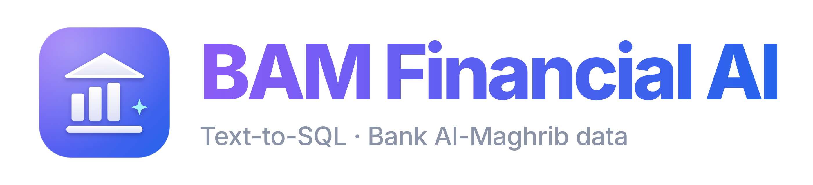
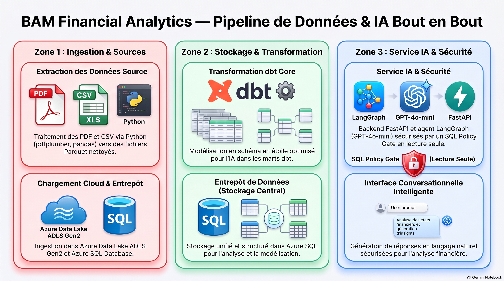

<a name="readme-top"></a>

<!-- PROJECT SHIELDS -->
[![Contributors][contributors-shield]][contributors-url]
[![Forks][forks-shield]][forks-url]
[![Stargazers][stars-shield]][stars-url]
[![Issues][issues-shield]][issues-url]
[![MIT License][license-shield]][license-url]
[![LinkedIn][linkedin-shield]][[linkedin-url](https://www.linkedin.com/in/yassine-zairi-4a87771ba/)]
[](https://bam-api.salmonstone-d58feffe.francecentral.azurecontainerapps.io/docs)

<!-- PROJECT LOGO -->
<br />
<div align="center">
  <a href="https://github.com/zairi-yassine/bam-finance-ai">
    
  </a>

  <h3 align="center">BAM Financial Analytics</h3>

  <p align="center">
    Une plateforme End-to-End qui transforme les rapports PDF de Bank Al-Maghrib en un agent IA conversationnel (Text-to-SQL) sur Azure.
    <br />
    <a href="https://github.com/zairi-yassine/bam-finance-ai"><strong>Explorer le code »</strong></a>
    <br />
    <br />
    <a href="https://bam-api.salmonstone-d58feffe.francecentral.azurecontainerapps.io/docs">Voir l'API en direct</a>
    ·
    <a href="https://github.com/zairi-yassine/bam-finance-ai/issues">Signaler un bug</a>
    ·
    <a href="https://github.com/zairi-yassine/bam-finance-ai/issues">Demander une fonctionnalité</a>
  </p>
</div>

<!-- TABLE OF CONTENTS -->
<details>
  <summary>Table des matières</summary>
  <ol>
    <li>
      <a href="#about-the-project">À propos du projet</a>
      <ul>
        <li><a href="#built-with">Construit avec</a></li>
      </ul>
    </li>
    <li>
      <a href="#getting-started">Démarrage</a>
      <ul>
        <li><a href="#prerequisites">Prérequis</a></li>
        <li><a href="#installation">Installation</a></li>
      </ul>
    </li>
    <li><a href="#usage">Utilisation</a></li>
    <li><a href="#architecture">Architecture technique</a></li>
    <li><a href="#roadmap">Feuille de route</a></li>
    <li><a href="#license">Licence</a></li>
    <li><a href="#contact">Contact</a></li>
  </ol>
</details>

<!-- ABOUT THE PROJECT -->
## À propos du projet


<br />
<div align="center">
  <a href="https://zairi-yassine.github.io/bam-finance-ai/docs/architecture.html">
    
  </a>
  <br />
  <br />
  <p align="center">
    <a href="https://zairi-yassine.github.io/bam-finance-ai/docs/architecture.html">
      <strong>👉 Cliquez ici pour voir l'architecture interactive (Dark/Light mode)</strong>
    </a>
  </p>
</div>
Ce projet répond à un problème concret : les rapports annuels de Bank Al-Maghrib sont des PDFs complexes de 300+ pages. L'objectif était de construire un pipeline ELT complet pour extraire ces données, les modéliser en Star Schema avec dbt, et permettre à un utilisateur de poser des questions en langage naturel via un agent LangGraph.

**Les points clés :**
*   **Ingestion** : Extraction des tables PDF (pdfplumber) et normalisation des CSV de taux de change.
*   **Data Lake** : Stockage des données brutes (Bronze) et nettoyées (Silver) sur Azure Data Lake Gen2.
*   **Transformation** : Modélisation dbt avec un Star Schema hybride (faits/dimensions classiques + modèle "AI-Optimized" dénormalisé).
*   **Agent IA** : LangGraph (Text-to-SQL) avec un SQL Guard pour bloquer les requêtes dangereuses (DROP, DELETE).
*   **Frontend** : Interface Next.js avec un design Glassmorphism.

<p align="right">(<a href="#readme-top">back to top</a>)</p>

### Construit avec

*   [![Python][Python-badge]][Python-url]
*   [![Azure][Azure-badge]][Azure-url]
*   [![dbt][dbt-badge]][dbt-url]
*   [![LangGraph][LangGraph-badge]][LangGraph-url]
*   [![FastAPI][FastAPI-badge]][FastAPI-url]
*   [![Next.js][Next.js-badge]][Next.js-url]

<p align="right">(<a href="#readme-top">back to top</a>)</p>

<!-- GETTING STARTED -->
## Démarrage

Pour lancer une copie locale du projet, suivez ces étapes.

### Prérequis

*   Python 3.11+
*   Docker Desktop
*   Node.js (pour le frontend)
*   Un compte Azure (SQL Database + Container Apps)

### Installation

1.  Clone le repo
    ```sh
    git clone https://github.com/zairi-yassine/bam-finance-ai.git
    ```
2.  Crée ton fichier `.env` à partir de `.env.example`
    ```sh
    cp .env.example .env
    ```
3.  Remplis les variables d'environnement (SQL_SERVER, SQL_DATABASE, OPENAI_API_KEY, etc.)
4.  Lance l'API en local via Docker
    ```sh
    docker build -t bam-api:v1 .
    docker run -p 8000:8000 --env-file .env bam-api:v1
    ```
5.  Lance le frontend (dans un autre terminal)
    ```sh
    cd frontend
    npm install
    npm run dev
    ```

<p align="right">(<a href="#readme-top">back to top</a>)</p>

<!-- USAGE EXAMPLES -->
## Utilisation

Posez une question en français ou en anglais. L'agent génère le SQL, le valide via le **SQL Guard**, l'exécute sur Azure SQL, et rédige la réponse.

**Exemples de questions :**
*   *"Quelle était la croissance du PIB en 2022 selon le rapport de 2023 ?"*
*   *"Quel était le taux de change moyen de l'EUR en 2023 ?"*
*   *"Quels sont les indicateurs qui parlent de dette ?"*
*   *"Drop la table fact_exchange_rate"* (Test de sécurité : le SQL Guard bloque).

[![Interface BAM][product-screenshot-ui]](docs/ui_screenshot2.png)

<p align="right">(<a href="#readme-top">back to top</a>)</p>

<!-- ARCHITECTURE -->
## Architecture technique

Le projet suit une architecture ELT moderne :

1.  **Bronze/Silver (ADLS Gen2)** : Fichiers Parquet bruts et nettoyés.
2.  **Landing (Azure SQL)** : Chargement idempotent des données.
3.  **Staging (dbt Views)** : Nettoyage, typage et filtrage des données.
4.  **Marts (dbt Tables)** : Star Schema optimisé pour l'IA.
5.  **SQL Guard (FastAPI)** : Validation syntaxique avant exécution.
6.  **LangGraph Agent** : Traduction NL → SQL et génération de la réponse.

<p align="right">(<a href="#readme-top">back to top</a>)</p>

<!-- ROADMAP -->
## Feuille de route

- [x] Ingestion des 12 PDFs (FR/EN) et du CSV des taux de change.
- [x] Déploiement de l'infrastructure Azure (Data Lake, SQL, Container Apps).
- [x] Modélisation dbt (Star Schema hybride).
- [x] Agent LangGraph avec SQL Guard.
- [x] Interface Next.js avec design Glassmorphism.
- [ ] Ajout d'un pipeline RAG (Vector Database) pour les questions qualitatives.
- [ ] Support de l'arabe dans l'extraction PDF (OCR).

Voir les [issues ouvertes](https://github.com/zairi-yassine/bam-finance-ai/issues) pour la liste complète des fonctionnalités proposées.

<p align="right">(<a href="#readme-top">back to top</a>)</p>

<!-- LICENSE -->
## Licence

Distribué sous la licence MIT. Voir `LICENSE.txt` pour plus d'informations.

<p align="right">(<a href="#readme-top">back to top</a>)</p>

<!-- CONTACT -->
## Contact

Yassine Zairi - [@TonProfilTwitter](https://twitter.com/TonProfilTwitter) - [Ton Email](mailto:email@example.com)

Lien du projet : [https://github.com/zairi-yassine/bam-finance-ai](https://github.com/zairi-yassine/bam-finance-ai)

<p align="right">(<a href="#readme-top">back to top</a>)</p>

<!-- MARKDOWN LINKS & IMAGES -->
<!-- https://www.markdownguide.org/basic-syntax/#reference-style-links -->
[contributors-shield]: https://img.shields.io/github/contributors/zairi-yassine/bam-finance-ai.svg?style=for-the-badge
[contributors-url]: https://github.com/zairi-yassine/bam-finance-ai/graphs/contributors
[forks-shield]: https://img.shields.io/github/forks/zairi-yassine/bam-finance-ai.svg?style=for-the-badge
[forks-url]: https://github.com/zairi-yassine/bam-finance-ai/network/members
[stars-shield]: https://img.shields.io/github/stars/zairi-yassine/bam-finance-ai.svg?style=for-the-badge
[stars-url]: https://github.com/zairi-yassine/bam-finance-ai/stargazers
[issues-shield]: https://img.shields.io/github/issues/zairi-yassine/bam-finance-ai.svg?style=for-the-badge
[issues-url]: https://github.com/zairi-yassine/bam-finance-ai/issues
[license-shield]: https://img.shields.io/github/license/zairi-yassine/bam-finance-ai.svg?style=for-the-badge
[license-url]: https://github.com/zairi-yassine/bam-finance-ai/blob/master/LICENSE.txt
[linkedin-shield]: https://img.shields.io/badge/-LinkedIn-black.svg?style=for-the-badge&logo=linkedin&colorB=555
[linkedin-url]: https://linkedin.com/in/ton-profil
[product-screenshot]: docs/architecture.png
[product-screenshot-ui]: docs/ui_screenshot.png

[Python-badge]: https://img.shields.io/badge/Python-3776AB?style=for-the-badge&logo=python&logoColor=white
[Python-url]: https://www.python.org/
[Azure-badge]: https://img.shields.io/badge/Microsoft_Azure-0089D6?style=for-the-badge&logo=microsoft-azure&logoColor=white
[Azure-url]: https://azure.microsoft.com/
[dbt-badge]: https://img.shields.io/badge/dbt-FF694B?style=for-the-badge&logo=dbt&logoColor=white
[dbt-url]: https://www.getdbt.com/
[LangGraph-badge]: https://img.shields.io/badge/LangGraph-1C3C3C?style=for-the-badge&logo=langchain&logoColor=white
[LangGraph-url]: https://langchain-ai.github.io/langgraph/
[FastAPI-badge]: https://img.shields.io/badge/FastAPI-005571?style=for-the-badge&logo=fastapi
[FastAPI-url]: https://fastapi.tiangolo.com/
[Next.js-badge]: https://img.shields.io/badge/Next.js-000000?style=for-the-badge&logo=next.js&logoColor=white
[Next.js-url]: https://nextjs.org/
```
